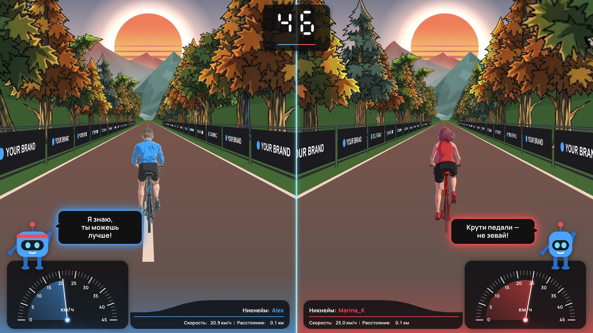
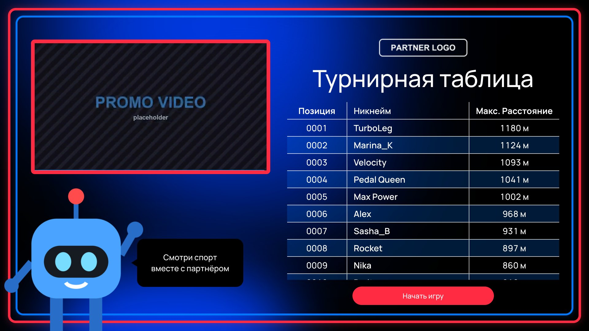
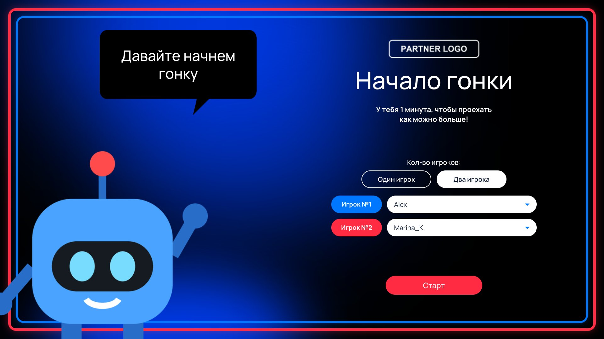
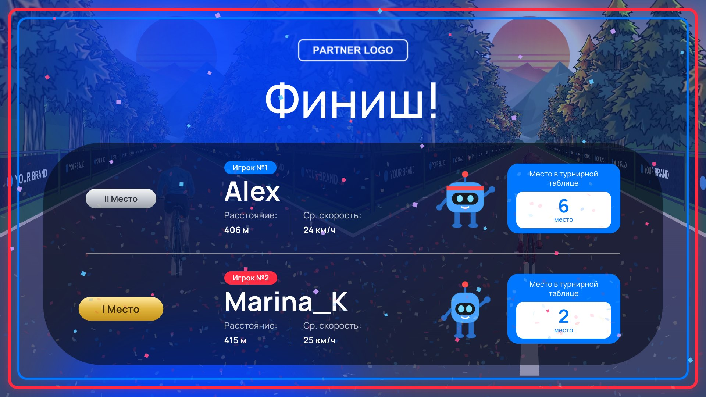
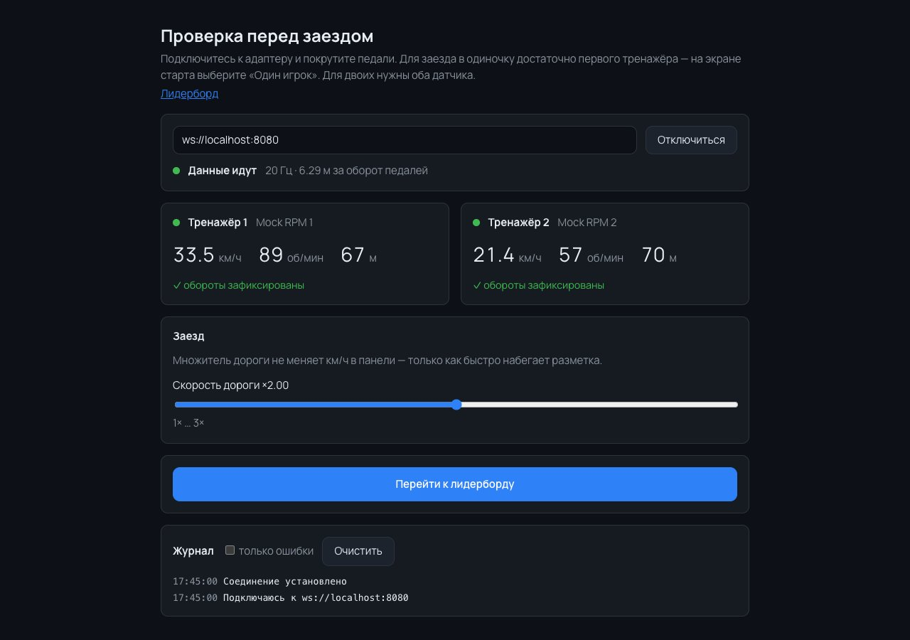
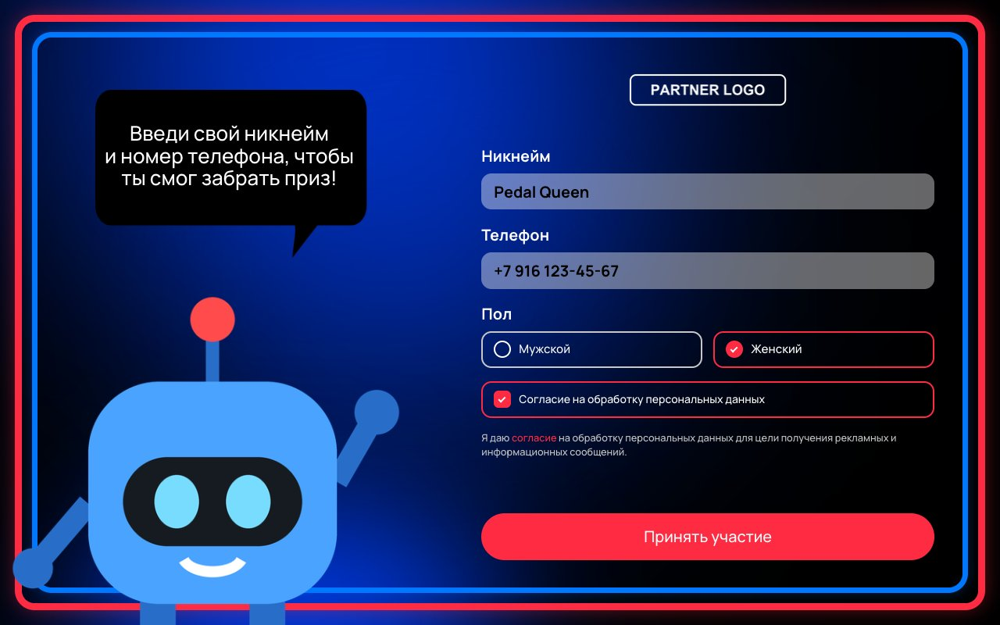
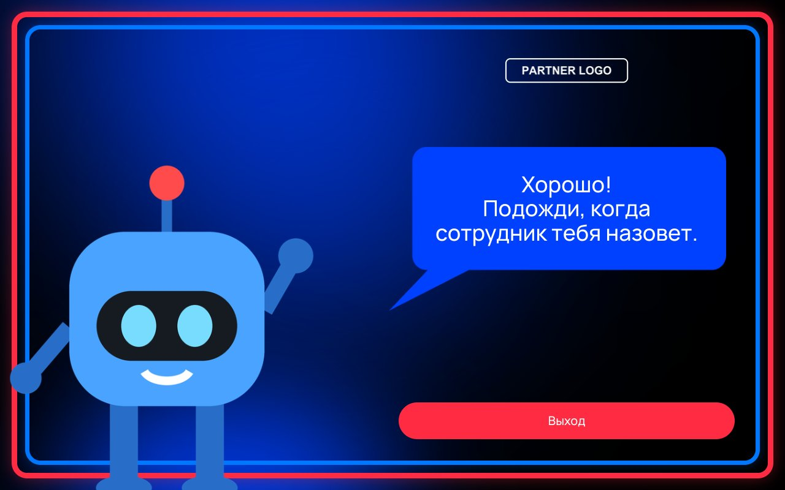

# Velo — head-to-head stationary bike racing

An interactive installation built for an offline event. Two people pedal real stationary
bikes, and on a big screen their cyclists race each other down a split-screen road. Each
rider's speed comes from the live cadence of a sensor on their crank arm. Participants sign
up on a tablet, and every result goes to a shared leaderboard.

The project covers the whole chain: from parsing raw Bluetooth / ANT+ packets to a
one-double-click launch on site, with no developer around.



> The UI is in Russian, as it was built for a Russian-speaking audience. The screenshots
> were taken with the built-in sensor simulator and demo data. Partner branding has been
> replaced with placeholders.

## Screens

| | |
| --- | --- |
|  **Leaderboard**: live table of best distances, looping promo reel |  **Race start**: solo or duel, pick registered riders |
|  **Finish**: winner, distance, average speed and leaderboard place |  **Hardware check**: adapter connection, live data from each bike, race settings |
|  **Registration (tablet)**: nickname, phone, consent |  **Registration done** |

## How it works

```
 Wahoo RPM ×2                                   ┌──────────────────────────┐
 (cadence sensors)                              │  velo-register (tablet)  │
     │  BLE (CSC)  or  ANT+ (USB stick)         │  nickname, phone, consent│
     ▼                                          └────────────┬─────────────┘
 ┌─────────────────────┐   WebSocket, 20 Hz    ┌─────────────▼─────────────┐
 │ velo-node (Node.js) │ ────────────────────▶ │     Supabase (Postgres)   │
 │ cadence → speed,    │   cadence, speed,     │   riders and best results │
 │ distance, sensor-to-│   distance            └─────────────▲─────────────┘
 │ player binding      │                                     │
 └─────────────────────┘                       ┌─────────────┴─────────────┐
                         ────────────────────▶ │   velo-game (big screen)  │
                                               │   Vue 3 + PixiJS 8        │
                                               └───────────────────────────┘
```

On site:

1. A participant signs up on the tablet, and **velo-register** writes them to Supabase.
2. On the start screen, the operator picks one or two riders and solo or duel mode.
3. **velo-node** reads crank revolutions from the sensors, computes speed and distance, and streams them to the game over WebSocket.
4. **velo-game** renders a one-minute race. At the finish it shows results and leaderboard places, and stores each rider's best distance.

## Components

| Folder | What it is | Stack |
| --- | --- | --- |
| [`velo-node`](velo-node) | Sensor adapter: BLE / ANT+ → telemetry over WebSocket | Node.js 24, TypeScript, `ws`, `@stoprocent/noble`, `ant-plus-next` |
| [`velo-game`](velo-game) | Race screen, hardware check, start screen, leaderboard | Vue 3, Pinia, Vue Router, PixiJS 8, Vite, SCSS, AssetPack |
| [`velo-register`](velo-register) | Rider sign-up form for a tablet | Vue 3, Vite, Supabase JS |
| [`supabase/migrations`](supabase/migrations) | DB schema, RLS policies, RPC for personal bests | PostgreSQL, Supabase |
| [`video-to-png`](video-to-png) | Sprite pipeline: video → frames → crop → background removal | Python, Pillow, NumPy, ffmpeg |
| [`MAC`](MAC), [`WIN`](WIN) | Double-click launchers and step-by-step guides for non-developers | bash, cmd |

## Technical highlights

**One interface for three data sources.** BLE, ANT+ and the simulator all implement the
same `CadenceSource` port and emit ready-made cadence. The core (`hub.ts`) doesn't know
where the data came from, and native modules are loaded dynamically. As a result, in `mock`
mode the project runs on any machine without Bluetooth or USB access.

**Cadence from raw packets.** The BLE Cycling Speed and Cadence profile and ANT+ Bike
Cadence carry the same fields: cumulative crank revolutions and the last event time in
1/1024 s ticks. Both are `uint16` and wrap around regularly. The math is shared between the
two transports and handles the wrap-around
([`domain/cadence.ts`](velo-node/src/domain/cadence.ts)).

**Speed via a virtual gear.** Wahoo RPM measures cadence only, so speed is computed as
cadence × wheel circumference × gear ratio. Cadence is exponentially smoothed. When the
signal drops, it decays to zero smoothly, so the on-screen rider never stops abruptly.

**Perspective on a 2D engine instead of 3D.** The road, lane markings, trees and banners use
a hand-written projection ([`projection.ts`](velo-game/src/game/projection.ts)): the camera
sits at a fixed height, and screen position is a division by distance. The static
background is redrawn only on resize. Moving objects come from pre-allocated sprite pools,
all lane dashes are a single `MeshSimple`, and banners are `PerspectiveMesh`. The frame loop
doesn't allocate new display objects.

**HUD separate from the scene.** The speedometers and rider panels over the canvas are plain
HTML/CSS, so the design can change without touching the renderer. The scene receives
telemetry through a function and knows nothing about Pinia.

**Built for real-world conditions.** The WebSocket client reconnects on its own, with
exponential backoff from 0.5 to 5 s. Connection state and a passed hardware check survive a
page reload. Sensors can be pinned to players by ID or bound automatically in discovery
order.

**No developer required on site.** `start.command` / `start.bat` free the ports, start the
adapter and the game, and open the browser. For Macs without admin rights, `PLAN_B` ships a
portable Node with SHA-256 verification, with no installer and no `sudo`.
[`pack-sensor-test.sh`](pack-sensor-test.sh) bundles everything into a single zip for the venue.

**TypeScript without a build step.** `velo-node` runs directly on Node 24 thanks to native
type stripping. All adapter types live in one file, with an explicit "contract with
velo-game" section mirrored on the frontend.

## Running locally (no bikes needed)

Requires Node.js 24+.

```sh
# 1. Adapter in simulator mode: two virtual riders
cd velo-node
npm install
cp .env.example .env
SOURCE=mock npm start          # ws://localhost:8080
```

```sh
# 2. Game
cd velo-game
npm install
cp .env.example .env           # URL and anon key of your Supabase project
npm run dev                    # http://localhost:5173
```

On the hardware check page, click "Подключиться" (Connect), and both bikes start receiving
simulator data. The start screen, leaderboard and registration need a Supabase project of
your own: apply the migrations from `supabase/migrations` and fill in `.env` in `velo-game`
and `velo-register`.

```sh
# 3. Registration (optional)
cd velo-register
npm install
cp .env.example .env
npm run dev
```

For details on the adapter and its protocol, see [`velo-node/README.md`](velo-node/README.md)
and [`velo-game/README.md`](velo-game/README.md) (both in Russian).

## On-site launch

Operators without programming experience use the **WIN** and **MAC** folders, not the
repository root. Each has a double-click launcher and a step-by-step guide (in Russian).

| Computer | Folder | Launch | Guide |
| --- | --- | --- | --- |
| Windows | `WIN` | double-click `start.bat` | `WIN/ИНСТРУКЦИЯ.txt` |
| macOS | `MAC` | double-click `start.command` | `MAC/ИНСТРУКЦИЯ.txt` |
| macOS without admin rights | `MAC/PLAN_B` | double-click `start.command` | `MAC/PLAN_B/ИНСТРУКЦИЯ.txt` |
